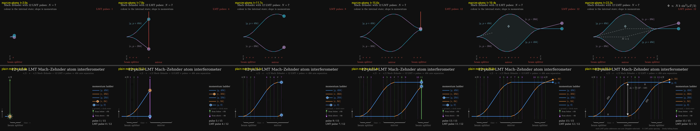

# P1 — 12-pulse LMT Mach–Zehnder

> make an animation of a 12-pulse LMT Mach zehnder interferometer

| | manim-atoms (A) | plain manim (B) |
|---|---|---|
| Tokens | 150.1k | 118.1k |
| Tool calls | 34 | 35 |
| Wall time | 10.4 min | 14.0 min |
| Renders | 3 of the new scene, plus 5 regression checks | 10 (6 full, 4 `-s`) |
| Code lines (no blanks, comments, docstrings) | **+78 net** (152 lines inserted, 22 deleted in `lmt.py`) | 279 |
| Scene | `interferometry/scenes/lmt.py::TwelvePulseLMT` | `plain_manim.py::LMTMachZehnder` |

## Interpretation
Both arms worked out on their own that a closed LMT Mach–Zehnder can't have exactly 12 pulses in total, and both read the request as **12 LMT pulses added to π/2–π–π/2, so 15 pulses**. They picked different LMT schemes:
- **A: every pulse drives both arms.** This is the single-photon symmetric scheme (Rudolph et al. 2020) that the package already draws. It gives N = 7 and arms 7ħk apart. The package steered A to this scheme, which happens to be the one AION uses.
- **B: each pulse addresses one arm.** This is the sequential, Doppler-selected scheme (Graham et al. style, 4n − 1 pulses). It gives n = 4 and arms 4ħk apart.

## Physics
- **A:**
  - Leg kets are |g, p+4ħk⟩ and |e, p−3ħk⟩ after the beam splitter, and swap correctly after the mirror's 7 pulses.
  - The arms close, and the ports are one recoil apart.
  - The plain sequence's three pulses are picked out in grey.
  - Flaw: the closing formula Φ ∝ N k sin²(ωT/2) is inherited from the base scene. It's the GW/ULDM signal form, not a generic LMT phase.
- **B:**
  - Pulse directions alternate correctly, and each g/e flip matches its momentum ladder level.
  - The mirror stage is pulses 4–6, then the π, then 7–9.
  - The arms close, with ports |g,0⟩ and |e,ħk⟩.
  - Every pulse is numbered.
  - Δz is labelled, but T isn't marked on the axis.

## Visuals
- **A** (`final_A.png`): clean and in the deck's style.
  - Has the enclosed area Φ, with the dashed N = 1 interferometer inside it for comparison.
  - A counter in the corner counts the LMT pulses.
  - Stage captions and π/2 / π labels run along the bottom.
- **B** (`final_B.png`): denser and more didactic.
  - Has numbered pulse lines, a momentum-ladder legend with U/L markers, and a pulse counter.
  - The labels are small at 480p.

## What the package gave A
- **Reused:** `lmz_pulses`, `lmt_history` and `kick_worldline`, all unchanged; all of `LMTMachZehnder`'s drawing; and the primitives.
- **Refactor:** `LMTMachZehnder` was hard-wired to `LMZ_ORDER`, so A turned it into a base class configured by class attributes, with hooks. `LMTMachZehnder` and `LargeMomentumTransfer` still render pixel-identical last frames; A checked this and I re-checked it.
- **Friction:**
  - The order was hard-wired.
  - `lmz_pulses` doesn't validate that n is odd, so an even n only fails later, at `lmt_history`'s closure assert.
  - `lmt_history` doesn't mark which pulses belong to the plain sequence.
  - `Integer` doesn't sit on the same baseline as `Tex`.

## Verdict
**The package helped.** A wrote about 3.5× less code, needed half the iterations on the new scene itself, and finished about 25% faster. It cost about 27% more tokens, spent reading the package. The package also anchored A on its own LMT scheme. That's good for AION, but it's a bias: B considered the sequential scheme, and A never did. A also left the package better than it found it, since `LMTMachZehnder` now takes any order.
