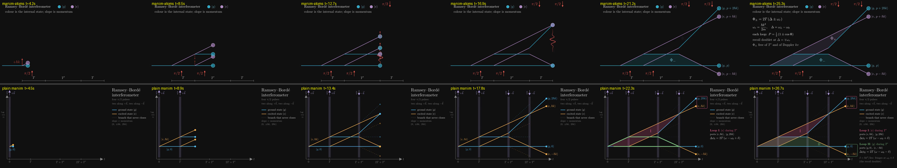

# P2 — Ramsey–Bordé

> animate a Ramsey–Bordé interferometer, showing both closed loops and the four output ports

| | manim-atoms (A) | plain manim (B) |
|---|---|---|
| Tokens | 185.7k | 88.5k |
| Tool calls | 44 | 20 |
| Wall time | 12.5 min | 7.1 min |
| Renders | 5 | 4 |
| Code lines (no blanks, comments, docstrings) | 271 (191 scene + 80 tool), plus 14 style lines | 207 |
| Scene | `interferometry/scenes/ramsey_borde.py::RamseyBorde` | `plain_manim.py::RamseyBorde` |

## Physics
Both chose Bordé's counter-propagating geometry (two π/2 along +k, then two along −k, T′ > T), and both get it right:
- Each loop's two arms both leave pulse 1's split point.
- One loop is excited throughout T′, and the other is in the ground state throughout T′.
- The ports are |g, 2ħk⟩, |e, ħk⟩, |g, 0⟩ and |e, −ħk⟩.
- The phases are 2T(Δ ± ω_r), which is the recoil doublet, and they don't depend on T′ or on kv.

They use different symbols but are consistent with each other.

## Visuals
- **A** (`final_A.png`):
  - In the package's house style: state colours, `beat()` stops, a wavepacket for each pulse, and recoil arrows.
  - The open branches fade out after pulse 3.
  - The ports are labelled, but not grouped by loop.
  - Uncluttered.
- **B** (`final_B.png`):
  - Has its own style: a t/z axis, a band for each pulse, and a legend.
  - The open branches stay on screen, dashed.
  - A coloured box groups each loop's two ports, and a card per loop gives its ports and phase.
  - More informative, and slightly busier.

## What the package gave A
- **Reused:** `make_atom`, `make_laser_pulse`, `draw_legs` (including its `extra` hook), `momentum_arrow`, `make_guide`, `state_label`, `lmt.recoil`, and the style constants.
- **Built itself:** a general pulse-tree engine (`beamsplitter_tree`: any π/2 sequence from either side, plus closure detection) and `sweep_pulse` (a wavepacket that crosses several atoms from above or below). Both are reusable, so the extra code buys future scenes something.
- **Friction:**
  - `absorb`, `emit` and `make_k_arrow` only work for a beam from below.
  - `lmt_history` only splits from below and fixes the pairs in advance.
  - `draw_ports` assumes a flat ground port and a rising excited one.
  - `arm_ket` only knows |g,p⟩ and |e,p+ħk⟩.
  - `MachZehnder.make_legend` is a staticmethod with its two kets hard-wired.

## Verdict
The package didn't make this faster: it took about twice the tokens and 1.8× the time. A's extra cost went into reading the package and its conventions, and into building general tools that fit them. The output matches the house style and leaves behind tools future scenes can use, but B's single scene is the better explainer.
