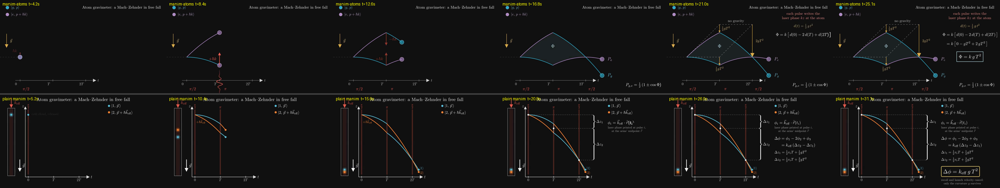

# P3 — Atom gravimeter (curved trajectories, k g T²)

> make an animation of an atom gravimeter: a Mach–Zehnder in free fall with curved trajectories, ending on the phase k g T²

| | manim-atoms (A) | plain manim (B) |
|---|---|---|
| Tokens | 145.4k | 83.4k |
| Tool calls | 36 | 21 |
| Wall time | 7.6 min | 5.7 min |
| Renders | 3 | 4 |
| Code lines (no blanks, comments, docstrings) | 181 (153 scene + 28 tool), plus 12 style lines | 212 |
| Scene | `interferometry/scenes/gravimeter.py::Gravimeter` | `plain_manim.py::AtomGravimeter` |

## Physics
Both are correct.
- **A:**
  - Uses the single-photon states the package uses (|g,p⟩, |e,p+ħk⟩), with the laser pointing up.
  - The atom is released from a trap at the first π/2.
  - Every leg is the free-fall leg bent by −½gt². This is `core.spacetime`'s displaced-leg mechanism, which was built for gravitational-wave-bowed legs.
  - The phase is k[d(0) − 2d(T) + d(2T)] = k[0 − gT² + 2gT²] = kgT².
  - The straight, no-gravity parallelogram is drawn dashed, with ½gT² and 2gT² drop arrows.
- **B:**
  - The textbook Raman gravimeter: |1⟩/|2⟩ states, with k_eff pointing down along g.
  - Arm midpoints are marked at each pulse, with braces for Δz₁ = ½v_rT + ½gT² and Δz₂ = ½v_rT + 3/2 gT².
  - Δφ = k_eff(Δz₂ − Δz₁) = k_eff gT², and an on-screen note says that recoil and launch velocity cancel.

## Visuals
- **A** (`final_A.png`):
  - The loop is wide and readable.
  - The no-gravity parallelogram makes the curvature argument at a glance.
  - Pulse labels sit along the bottom.
  - Small quirk: the 0/T/2T tick labels are offset left of their ticks.
- **B** (`final_B.png`):
  - Adds the apparatus: a vertical tube with the clouds falling, at the same height scale as the diagram.
  - The arms are nearly on top of each other, so the loop reads as a thin sliver.

## What the package gave A
- **The key reuse:** `draw_wavy_legs` / `leg_point`, the displaced legs from `core/spacetime`. They drew curved legs that still pass exactly through the pulse corners, with no new motion code. A also reused `absorb`, `emit`, `momentum_arrow` and `make_k_arrow`, and subclassed `MachZehnder` for its legend, pulse captions and `beat()`.
- **Friction:**
  - The displaced-leg mechanism is documented only in terms of waves and gradiometers. A found it by grepping. Nothing in the skill or `primitives` says "`draw_wavy_legs` is `draw_legs` for curved arms."
  - `draw_ports` draws straight ports only.
  - The legend and pulse captions are static methods on the `MachZehnder` scene, so reusing them means subclassing the scene.

## Verdict
**Neutral on effort; slight edge to A on the result.** A cost about 1.75× the tokens and 1.3× the time, mostly reading the package, and wrote about 15% less code. The general spacetime layer stretched to physics it wasn't written for, which is a good sign for the package's design, but only after a search. One line in the skill would have made it cheap.
