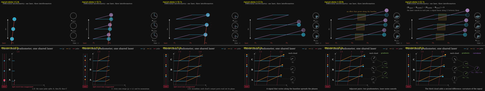

# P4 — Three-cloud gradiometer

> animate a gradiometer with three atom clouds sharing one laser instead of two

| | manim-atoms (A) | plain manim (B) |
|---|---|---|
| Tokens | 156.1k | 83.3k |
| Tool calls | 50 | 21 |
| Wall time | 9.5 min | 8.0 min |
| Renders | 6, plus 18 `-s` regression renders | 4 |
| Code lines (no blanks, comments, docstrings) | 325 new (255 scene + 70 tool), plus 8 net in `gradiometer.py` (34 inserted, 15 deleted) | 245 |
| Scenes | `interferometry/scenes/multi_gradiometer.py::MultiGradiometer` and `MultiGradiometerContinuous` | `plain_manim.py::ThreeCloudGradiometer` |

## Physics
Both are correct, and both say what the third cloud is for.
- **A:**
  - Three Sr clock interferometers, evenly spaced along one baseline.
  - Each pulse climbs at light speed, so it reaches the clouds L/2c apart.
  - Each pulse writes the same φ_n into all three, so all three dials end on the same laser sector.
  - A signal that grows linearly along L steps the dials on by equal amounts. The scene ends on (Φ_u − Φ_m) − (Φ_m − Φ_l) = 0: a second difference kills anything linear in L, which is how AION tells gravity-gradient noise from signal.
- **B:**
  - Same geometry, with tilted light-like pulse lines and the kinks on them, plus the tube with its laser.
  - Laser phase noise is a live random walk, and all three needles jitter together.
  - The two gradient dials and the curvature dial φ_A − 2φ_B + φ_C are computed from the cloud phases, so they stay perfectly still.
  - The signal has a nonlinear profile, so the curvature dial reads nonzero.

## Visuals
- **A** (`final_A.png`):
  - Uses exactly the visual language of the existing two-cloud `Gradiometer` slide: parallelograms, the effect boxes, clock-hand dials, φ₁ φ₂ φ₃ along the bottom.
  - In a talk, it reads as "the same thing, with a third cloud".
  - The closing caption is awkward ("…a signal linear along L between them").
  - Comes in both the stop-start and the continuous variants the deck uses.
- **B** (`final_B.png`):
  - A tube, the diagram, and a tree of dials going cloud → gradient → curvature.
  - The noise-cancellation demonstration is live, not asserted.
  - A stronger standalone explainer.

## What the package gave A
- **Reused:** a lot. `gradiometer_frame`, `vertices`, `photon_worldline`, `climbing_pulse`, `Gradiometer` and `GradiometerBase` (arms, hands, dials, ports, laser jumps), `RunsContinuously`, the clock tools (`make_dial`, `phase_sweep`, `ground_share`, `live_ports`), and the spacetime helpers (`carry`, `worldline`, `growing_trail`, `wound_with_jumps`, `run_to`).
- **Refactor:** `GradiometerBase` hard-coded two clouds (`"low"`/`"up"` branches, `big[k]` indexed `0 if low else 2`, module-global dial positions). A generalised it to `CLOUDS`, which needed a regression check over nine scenes. All 9 last frames are pixel-identical; A checked this and I re-checked it against a worktree of the previous commit.
- **Friction:**
  - `fire_pulse` and `sweep_pulse` only know a near and a far crossing, and `fire_pulse` sorts by `GR_MID_Z`.
  - `vertices()` fixed the arm length.
  - `Gradiometer.construct` is one long method, so its effect step and readout were copied rather than reused.

## Verdict
**Package cost more; the result fits the talk better.**
- A took about 1.9× the tokens, 2.4× the tool calls and 1.2× the time, and wrote more code, though it delivered two scenes.
- A's real gain is integration: the third cloud slots into the deck's existing gradiometer story, and `GradiometerBase` now takes N clouds.
- If the goal is "a good animation of this idea", B was cheaper and better. If the goal is "the next slide in this talk", A is the one you'd use.
