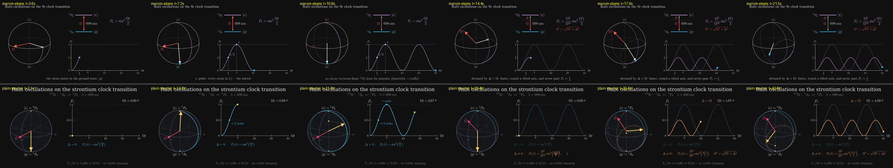

# P5 — Rabi oscillations on the Sr clock transition

> animate Rabi oscillations on the strontium clock transition, showing the Bloch vector and the excited-state population together

| | manim-atoms (A) | plain manim (B) |
|---|---|---|
| Tokens | 138.5k | 80.0k |
| Tool calls | 33 | 21 |
| Wall time | 8.9 min | 6.9 min |
| Renders | 4, plus 2 regression renders | 3 |
| Code lines (no blanks, comments, docstrings) | 219 (201 scene + 18 physics), plus 23 style lines and a small `two_level` extension | 189 |
| Scene | `interferometry/scenes/rabi.py::RabiOscillations` | `plain_manim.py::RabiBloch` |

## Physics
Both are correct, and they are strikingly similar.
- Both use ⁸⁷Sr ¹S₀ ↔ ³P₀ at 698 nm, starting in |g⟩ with no damping, and both justify that: Γ ~ 1 mHz.
- Both time axes run 0 to 4π in Ωt.
- Both play a resonant run, then the same drive detuned by Δ = Ω, with the resonant curve kept dimmed as a reference.
- Both use P_e = (Ω²/Ω′²) sin²(Ω′t/2) and end at P_e ≈ 0.13 at Ωt = 4π, which checks out.
- **A:** marks π/2 and π on the curve and ties them to "the beamsplitter" and "the mirror".
- **B:** drives the Bloch vector about (Ω, 0, Δ), with an explicit Ω⃗ arrow at 45° in the detuned run.

## Visuals
- **A** (`final_A.png`):
  - Uses the package's level diagram, with a dashed detuned laser line drawn Δ below |e⟩. This helper was added in this run.
  - A caption line per beat.
  - Clean house style.
  - The drive vector Ω′ is not on screen in the final frame.
- **B** (`final_B.png`):
  - A shaded sphere with depth-cued trails, labelled axes, a live Ωt readout, and the two formulas colour-matched to the two curves.
  - A slightly richer readout panel.

## What the package gave A
- **Reused:**
  - `BlochView`: projection, outline, ring, and curves split into front and back. This is exactly the piece B spent most effort building by hand.
  - `make_level_diagram` and `transition_glow` from `species/two_level`.
  - `slide_title`, `state_label` and the style constants.
- **Extended:** `make_level_diagram` gets a `gap_tex` argument and `transition_glow` a `detuning`, plus a new `resonance_line`. `SinglePhotonMachZehnder`, the only other user, still renders a pixel-identical last frame; I re-checked it.
- **Friction:**
  - `BlochView` lives in `interferometry/tools/squeezing.py`, so a Rabi scene imports it from the squeezing module. It belongs in its own module, low enough that `species/` can use it.
  - `make_level_diagram` returns a flat VGroup that has to be indexed by position.
  - There is no helper for a ValueTracker-driven curve that plots as it goes.

## Verdict
**Neutral on quality; the package cost more.** A took about 1.7× the tokens and 1.3× the time, and wrote about the same amount of code. `BlochView` saved A the hardest part, the depth-split projection. But A paid that back reading the package and in a two-module extension to fit a detuned laser line into the level diagram.
