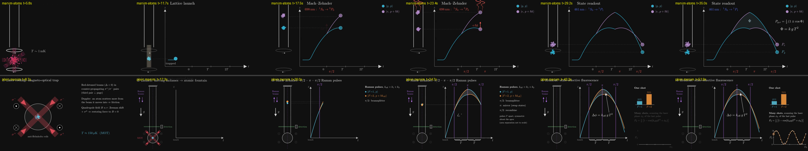

# P6 — MOT → fountain → Mach–Zehnder

> animate atoms being cooled in a MOT, launched upward into a fountain, and interrogated by a Mach–Zehnder sequence

| | manim-atoms (A) | plain manim (B) |
|---|---|---|
| Tokens | 197.7k | 114.9k |
| Tool calls | 35 | 31 |
| Wall time | 13.3 min | 12.6 min |
| Renders | 2, plus 12 regression renders | 3 |
| Code lines (no blanks, comments, docstrings) | 325 (238 scene + 87 tool), plus a 26-line `absorb`/`emit` extension in core and style lines | 426 |
| Scene | `aion/scenes/fountain.py::Fountain` | `plain_manim.py::FountainMachZehnder` |

## Interpretation
- **A:** Sr, the package's species and AION's.
  - A blue MOT at 461 nm (~1 mK), then a red MOT at 689 nm (~2 µK).
  - A moving optical lattice launches the cloud, as AION and MAGIS do.
  - π/2–π–π/2 on the 698 nm clock line, symmetric about the apex.
  - Readout by 461 nm fluorescence.
- **B:** the textbook ⁸⁷Rb Kasevich–Chu fountain.
  - A σ±/anti-Helmholtz MOT (~150 µK), then sub-Doppler molasses (~3 µK).
  - Moving molasses launches the cloud, with v₀ = √2 δ/k for 45° beams.
  - Raman π/2–π–π/2 with k_eff.
  - State-selective detection, with bars for one shot and a scanned fringe over many shots.

## Physics
Both are correct at cartoon level, and both say on screen that the recoil is exaggerated.
- **A:**
  - The loop closes, with symmetric pulses about the apex. At the π pulse, the ground arm absorbs (+ħk) and the excited arm is driven down by stimulated emission (−ħk).
  - It ends on P = ½(1 ± cos Φ) and Φ = kgT².
  - The readout isn't state-selective: both ports are imaged at once. A says so.
- **B:**
  - Correct moving-molasses kinematics, and the loop closes.
  - Δφ = k_eff gT², and the fringe P₂ = ½[1 − cos(k_eff gT² + φ_L)] with this shot's point carried over to it.

## Visuals
- **A** (`final_A.png`):
  - The apparatus and the space-time diagram share one height axis, with tie lines between them and both run on one lab clock.
  - The MOT stages use the trapping topic's own beams, coils and atom clouds, and stage headings show the transition used at each step.
  - The loop is wide and readable.
  - Small quirks: the 0/T/2T tick labels sit offset from their pulse labels, and the scene ends with an empty-looking MOT.
- **B** (`final_B.png`):
  - Four titled stages with an explanatory text column.
  - The detection beam, one-shot bars and the fringe scan make the readout a strong ending.
  - The two arms nearly overlap, so the loop is a sliver.

## What the package gave A
- **Reused:** the most of any prompt.
  - From trapping: `MotBeams`, `Coils`, `AtomCloud` (loading, temperature, glow), `stage_heading` and the cooling temperatures.
  - From core: `absorb` and `emit`, the spacetime clock (`worldline`, `carry`, `growing_trail`, `run_to`), and `fluoresce`.
  - The legend and pulse captions, by subclassing `MachZehnder`.
  - `curved_loop` from `interferometry/tools/gravimeter.py`, **which P3's package build had added earlier in this test**: the package compounding as it's used.
- **Extended:** `absorb`/`emit` take `also=[(x, atom)]`, to fire twin pulses in the apparatus and on the diagram. I compared **every frame** of the four scenes that use them before and after, and all are identical.
- **Friction:**
  - The layering rule: interferometry and trapping can't import each other, so a generic MOT-plus-interferometer scene has to live in `aion/`.
  - `AtomCloud` can't move, so following a trajectory means mutating `cloud.center` from an updater placed first.
  - `Coils` hard-codes its size.
  - `stage_heading` takes a `Stage` keyed to the timeline's colours, so the new headings borrow unrelated keys.

## Verdict
**Package helped with composition and cost more tokens.** A wrote 24% less code in the same time, using about 1.7× the tokens. It came out Sr- and AION-specific, which matters for this talk. B is the more complete general explainer, with its MOT physics text, molasses and the fringe scan.
